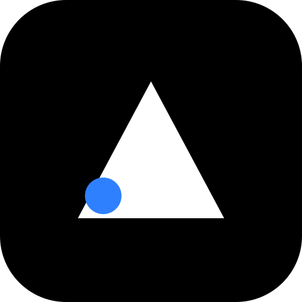

<p align="center">
  
</p>

<h1 align="center">深探</h1>

<p align="center"><strong>DeepExplorer</strong></p>

<p align="center">
  深探是一个偏 Nightly 视觉、带内置 DeepSeek 助手的极简 Android WebView 浏览器。<br>
  A minimalist, glass-styled Android browser with an inline DeepSeek assistant.
</p>

<p align="center">
  
  
  
</p>

> 应用名：深探（仓库名仍为 DeepExplorer）。项目完全使用 Android 框架 API，没有 AndroidX、Gradle、Lottie 或 WebView 壳依赖。构建脚本直接调用 `aapt`、`javac`、`d8`、`zipalign`、`apksigner`。

## 功能

- **WebView 浏览器**：多标签（最多 6 个）、前进/后退/主页、地址栏滚动收起、页面淡入。
- **内置 DeepSeek 助手**：SSE 流式回复、Markdown 渲染、`deepseek-chat` / `deepseek-reasoner` 切换、浏览网页时右下角快捷入口。
- **搜索引擎选择**：Google、Bing、DuckDuckGo、Brave、Startpage、Ecosia、Qwant、Yandex、百度、搜狗、360、神马；选择本地持久化。
- **首页组件**：天气、地址快捷入口、便签、格言四种卡片，在「设置 → 首页组件」里开关和编辑；格言来自「一言」在线库（文学 / 诗词 / 哲学，缓存最近 24 条），断网时回落到内置格言；天气使用无需 Key 的 wttr.in。
- **Nightly 风格视觉**：深紫/品红/靛蓝主题、半透明玻璃层、圆角搜索框、主题色与首页背景图、内置字体切换。
- **网络状态提示**：断网红色横幅，恢复后绿色过渡 2 秒。
- **网络环境智能诊断**：在线状态下，境外常见域名发生超时/连接/DNS 错误时，展示 MD3 风格提示，并在 5 分钟内按基础域名去重。
- **本地错误页**：诊断触发时用 `assets/error.html` 替换系统错误页，提供「重试」。
- **下载管理**：从网页下载文件，显示确认提示、下载横幅、实时进度/速度/文件名，并可打开已下载文件。
- **Firefox 式工具**：书签、页面内查找、桌面版网站、分享、页面菜单。
- **无账号、无插件、无遥测**：API Key 只保存在本机，不上传到除 DeepSeek API 以外的服务。

## 下载 / Download

APK 不提交到仓库。请到 GitHub **Releases** 下载（1.9.0 起包含首页组件）：

```text
https://github.com/Deliciousdiamond/DeepExplorer/releases
```

首次使用 AI 前，在「设置」里填入自己的 DeepSeek API Key（`sk-...`）。仓库不包含任何 API Key。

1.9.0 起首页支持可选组件：天气需要联网（wttr.in，无需 Key），地址卡片用来放常用网址，便签与格言完全离线。

## 截图

真实截图放在 [`docs/screenshots`](docs/screenshots/README.md)。发布前请先移除个人信息、API Key 和私人壁纸。

## 构建 / Build

项目不使用 Gradle，也不包含 Android SDK。你需要：

- JDK（含 `javac` / `keytool`）
- Android SDK Build-Tools（`aapt`、`d8`、`zipalign`、`apksigner`）
- Android Platform 29 的 `android.jar`
- `zip`、`bash`

```bash
git clone https://github.com/Deliciousdiamond/DeepExplorer.git
cd DeepExplorer

# 1. 生成一个本地签名密钥（不会提交到 Git）
export KEYSTORE_PASS='choose-a-strong-password'
./scripts/generate-keystore.sh

# 2. 指向 SDK 并构建
export ANDROID_JAR="$HOME/Android/Sdk/platforms/android-29/android.jar"
export KEYSTORE="keystore/release.jks"
export KEY_ALIAS="release"
./build.sh
```

产物：`build/DeepExplorer.apk`。

更详细的桌面端 / Termux 步骤、环境变量和常见错误见 [BUILDING.md](BUILDING.md)。

> 在 Termux/DSH 这类环境里，如果 `./build.sh` 提示 `bad interpreter`，改用：

```bash
bash build.sh
```

第一次发布到 GitHub 的完整步骤见 [GITHUB_GUIDE.md](GITHUB_GUIDE.md)。

## 项目结构

```text
DeepExplorer/
├── app/
│   ├── AndroidManifest.xml
│   ├── assets/                 # ai.html / error.html (marked inlined)
│   ├── res/                    # layouts, drawables, strings, themes
│   └── src/com/deliciousdiamond/deepexplorer/
├── docs/
│   ├── icon.svg
│   └── screenshots/
├── scripts/generate-keystore.sh
├── build.sh                    # no-Gradle build
├── BUILDING.md
├── GITHUB_GUIDE.md
├── CONTRIBUTING.md
├── SECURITY.md
├── CHANGELOG.md
├── THIRD_PARTY_NOTICES.md
└── LICENSE
```

源码按功能拆分为：

- `MainActivity.java`：浏览器壳、标签、主题、设置、书签、查找、诊断、错误页
- `AiClient.java`：DeepSeek SSE 客户端
- `SettingsStore.java`：本地偏好
- `BookmarkStore.java`：本地书签
- `SearchEngine.java`：搜索引擎表
- `StorageUtils.java`：缓存统计与清理

## 隐私与权限

| 权限 | 用途 |
|---|---|
| `INTERNET` | 加载网页、调用 DeepSeek API |
| `ACCESS_NETWORK_STATE` | 网络状态横幅与诊断 |

- 不申请存储权限；主页背景图通过系统文件选择器获取持久 URI。
- API Key 存在本机 `SharedPreferences`，不写入日志、不提交仓库。
- 没有崩溃上报、统计、广告 SDK。
- 应用退出时会清理 WebView 缓存和浏览历史；书签、主题和 API Key 保留。

## 已知限制

- 依赖系统 WebView 版本；页面能力受设备 WebView 限制。
- 网站字体跟随通过 WebView 字体族 + 注入 CSS 实现。CSP、Shadow DOM、跨域 iframe 等场景可能无法强制覆盖；图标字体已尽量排除。
- 网络诊断只对常见境外域名触发，避免对普通站点误报。
- 不提供账号、同步、插件体系。
- 项目目前只针对 Android 10（targetSdk 29）验证，更高版本可运行但未逐一适配。

## 声明 / Disclaimer

- 本项目不是 Mozilla Firefox，也不隶属于 Mozilla；视觉风格只是对 Firefox Nightly 的致敬。
- 网络诊断的交互参考 Microsoft Edge 的错误处理思路，不隶属于 Microsoft。
- DeepSeek 是 DeepSeek 公司的产品；本项目只调用其公开 API，不隶属于 DeepSeek。
- 请遵守你所在地区的法律法规以及所访问网站的服务条款。

## 参与贡献

见 [CONTRIBUTING.md](CONTRIBUTING.md)。安全问题请按 [SECURITY.md](SECURITY.md) 私下报告，不要在公开 Issue 中贴 API Key。

## License

[MIT](LICENSE) © 2026 Deliciousdiamond
